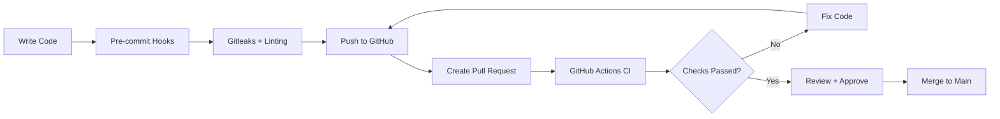

## Stage 1 – Local Development & Code Validation

_(Local → GitHub → PR → CI → Merge to Main)_

Catch issues early, before code reaches the main branch.

- **Pre-commit:** Runs linting, formatting and code quality checks before committing.
- **Gitleaks:** Scans code for exposed secrets, API keys and passwords.
- **Pull Request (PR):** Triggers CI tests before code can be merged.
- **Branch Protection:** Requires successful CI checks and code reviews before merging.

**Goal:** Fail fast and prevent bad code from reaching main.



### Implementation Steps

- Install Gitleaks

```bash
# Installation via brew
brew install gitleaks
# Verify installation
gitleaks version
# Simple Basic Scan the current directory's Git history
gitleaks git .
# Output results as JSON
gitleaks git --report-format json --report-path results.json .
```

- Install pre-commit framework using homebrew

```bash
# Install pre-commit framework
brew install pre-commit

# Create .pre-commit-config.yaml Configuration at the root of project
touch .pre-commit-config.yaml
```

```yaml
# Add the following configuration to .pre-commit-config.yaml
repos:
  # 🔐 Security: Gitleaks Secret Scanner
  - repo: local
    hooks:
      - id: gitleaks
        name: Gitleaks (Secret Scanner)
        language: system
        entry: gitleaks protect --staged --verbose --redact
        pass_filenames: false

  # 🧹 Linting & Formatting Examples

  # 🐹 Golang: golangci-lint
  - repo: local
    hooks:
      - id: golangci-lint
        name: Golangci-Lint
        language: system
        description: Fast, parallel runner for Go linters
        entry: bash -c 'cd app && golangci-lint run --timeout=5m ./...'
        files: ^app/.*\.go$
        pass_filenames: false

#   # 🧹 Python Example (Keep, modify, or remove based on your needs)
#   - repo: https://github.com
#     rev: v0.9.0
#     hooks:
#       - id: ruff
#         name: Ruff Linter
#         args: [ --fix ]
#       - id: ruff-format
#         name: Ruff Formatter

#    # JavaScript Example / TypeScript (ESLint & Prettier)
#   - repo: https://github.com
#     rev: v4.0.0-alpha.8
#     hooks:
#       - id: prettier
#         name: Prettier Formatter
#   - repo: https://github.com
#     rev: v9.14.0
#     hooks:
#       - id: eslint
#         name: ESLint Linter
#         files: \.[jt]sx?$ # Run only on JS/TS extensions
```

- Install/Register the pre-commit Hooks into Local Git (.git/hooks)

```bash
# Register Hook locally
pre-commit install # This should generate a success message: pre-commit installed at .git/hooks/pre-commit
# Verify hook was created
cat .git/hooks/pre-commit
# Ad-hoc Ops for clean and running pre-commit manually
pre-commit clean # Cleans cache of previous runs
pre-commit run --all-files  # Run test manually against all files
```

- Simulate Test by Adding File that contains some values - Test without committing `gitleaks dir . --verbose --redact`

```bash
# Add Fake File
echo 'FAKE=xxxxxxxxx' > file.txt
# Stage secret.txt
git add file.txt
# Commit it to trigger hooks
git commit -m "test: simulate test"
# Roll back committed secret and delete
git restore --staged file.txt
rm file.txt
```
